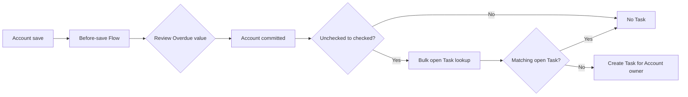

# 900001: Flows

- Work item ID: 900001
- Design files: [Overview](overview.md) [Components](components.md) [Flows](flows.md) [AC coverage](ac-coverage.md)

## Before-save calculation

`Account_Review_Overdue_Before_Save` receives each Account's `Last_Review_Date__c`. It sets `Review_Overdue__c` to true when the date is blank or is strictly less than today's date minus 365 days, and false otherwise. A date exactly 365 days before today is false.

The Flow is bulk-safe: it uses before-save record values and does not perform SOQL or DML.

## After-save task transition

`Account_Review_Overdue_After_Save` evaluates the prior and current values. It adds an Account to a collection only on a false-to-true transition.

For that collection, it performs one Task SOQL lookup for open Tasks whose subject is `Account review overdue` and whose AccountId/WhatId matches the changed Accounts. It compares existing AccountIds/WhatIds outside loops, then creates one Task per missing Account with subject `Account review overdue`, status open, and OwnerId equal to Account OwnerId.

## Boundaries and errors

- Save calculation and Task creation use the same Account save transaction; Task creation is synchronous.
- The implementation must use collection variables and collection SOQL/DML elements, never queries or DML inside loops.
- Task create faults remain observable and prevent the save according to the implementation's fault handling; no partial silent success is allowed.
- Flow versions must retain the previous active version while testing the new version and deactivate the old version only as an explicit implementation decision.

